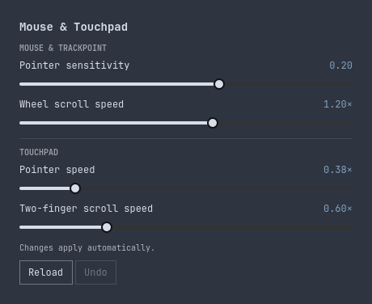

# Mouse & Touchpad for Omarchy

Fine-tune your pointer without editing Lua. A small Omarchy bar plugin with separate mouse and touchpad controls, automatic saving, and one-click undo.

[](https://github.com/1vecera/omarchy-pointer-settings/actions/workflows/checks.yml) [](https://github.com/1vecera/omarchy-pointer-settings/releases/latest) [](LICENSE)

<p align="center"></p>

- **Separate controls:** mouse sensitivity, wheel scrolling, mouse and touchpad adaptive acceleration, touchpad motion, and two-finger scrolling.
- **Automatic apply:** move a slider; your changes save after a 300 ms pause. No Apply button.
- **Native appearance:** uses Omarchy's theme, sliders, buttons, and keyboard-aware popup.
- **Recoverable edits:** private backups, guarded undo, and rollback if Hyprland rejects a change.
- **Local operation:** no telemetry, account, network calls, or background service.

## Install

Requires Omarchy's Quickshell plugin system, Hyprland's **Lua configuration** with `reload config-only`, `uv`, and Python 3.13+ at `/usr/bin/python`. Tested on Omarchy 4.0.2. Older installations using `input.conf` are not supported.

```sh
omarchy plugin add https://github.com/1vecera/omarchy-pointer-settings.git --enable
```

Click the mouse icon in your bar. Opening the panel only reads your settings; moving a slider saves them. The Python helper uses only the standard library and downloads no packages.

Update, disable, or remove the plugin:

```sh
omarchy plugin update daniel.pointer-settings
omarchy plugin disable daniel.pointer-settings
omarchy plugin remove daniel.pointer-settings
```

Disabling or removing the plugin leaves your saved speeds in place. **Undo** restores the previous successful save, including after reopening the panel. **Reload** discards pending changes and reads the current configuration. Tab moves between controls, arrow keys adjust a slider, and Escape closes the popup.

To open it from a launcher or keybinding, use `omarchy-shell daniel.pointer-settings toggle`.

## What the controls change

| Control | Range | Effect |
| --- | --- | --- |
| Mouse pointer sensitivity | −1 to 1 | Global Hyprland sensitivity; also affects a TrackPoint or other pointer that inherits it. |
| Mouse adaptive acceleration | On/off | Selects libinput's adaptive or flat profile for the mouse. |
| Mouse wheel scroll speed | 0.1× to 2× | Global scroll multiplier. |
| Touchpad pointer speed | −1 to 1, or 0.05× to 2× | Device sensitivity for flat/adaptive acceleration, or motion gain for a supported custom profile. |
| Adaptive acceleration | On/off | Selects libinput's adaptive or flat profile for the touchpad. |
| Two-finger scroll speed | 0.1× to 2× | Separate touchpad scroll multiplier. |

For a linear custom touchpad profile, the plugin changes the motion curve itself. libinput's ordinary sensitivity control does not affect a custom profile. Separate custom scrolling points are preserved. See the [libinput documentation](https://wayland.freedesktop.org/libinput/doc/latest/pointer-acceleration.html#the-custom-acceleration-profile).

The plugin reads `~/.config/hypr/input.lua`, with `XDG_CONFIG_HOME` support. A stock file containing only comments works: inherited settings are read from Hyprland, and missing overrides are added on your first change. When a touchpad inherits global sensitivity, its current speed is pinned in a device override so the mouse slider can change independently. Desktops without a detected touchpad show only the mouse controls.

## Compatibility and recovery

The editor supports literal `hl.config({ input = { … } })` and `hl.device({ … })` tables, including repeated overrides. It handles one touchpad whose configured or detected name contains `touchpad` or `trackpad`. Custom touchpad motion profiles must be linear, with two points starting at zero. Multiple touchpads, computed settings, and unsupported acceleration profiles are rejected with an explanation.

Your `input.lua` must be loaded by Hyprland. Device-specific mouse overrides and settings supplied by other Lua files are outside the editor's scope. Values outside a slider's range remain untouched until you change that control. This is a community plugin, independently maintained.

Each save checks for outside edits and existing configuration errors, backs up the file, replaces it atomically, and runs `hyprctl reload config-only` followed by `hyprctl configerrors`. A rejected reload restores the previous file. Existing literal values are edited in place; missing overrides are appended. Unrelated settings and comments are retained. Comments describing numeric values are not rewritten.

Backups and undo history live in `~/.local/state/omarchy/pointer-settings/`, with `XDG_STATE_HOME` support. Undo refuses to overwrite a newer edit made elsewhere. For manual recovery, restore the wanted `backups/input-*.lua` file to `~/.config/hypr/input.lua`, then run `hyprctl reload config-only` and `hyprctl configerrors`. Backups are retained until you delete them.

## Development

See [CONTRIBUTING.md](CONTRIBUTING.md) for local checks, isolated UI testing, and the source layout. [CHANGELOG.md](CHANGELOG.md) records releases. Bug reports and small improvements are welcome in [Issues](https://github.com/1vecera/omarchy-pointer-settings/issues).

Released under the [MIT license](LICENSE).
